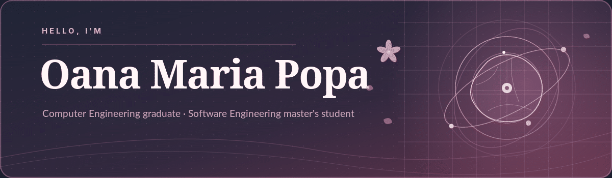
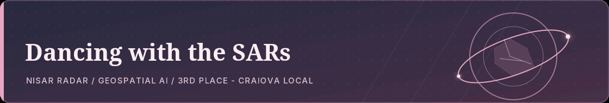
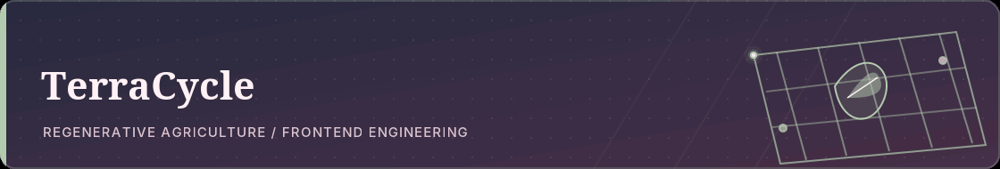

  

  
  
  

---

### A little about me

I'm Oana, a **Computer Engineering graduate** currently pursuing a **Master's degree in Software Engineering at the University of Craiova**. I enjoy building applications that connect thoughtful interfaces with the systems behind them — from secure APIs and database-driven platforms to machine learning and interactive 3D experiences.

My work spans individual academic projects and team-based hackathons. I'm especially interested in **full-stack software development and embedded systems**, and I enjoy exploring different areas of software engineering.

Currently exploring **software engineering internship and junior opportunities**.

### Selected work

**Dancing with the SARs** · NASA Space Apps Challenge 2026 · **3rd Place, Craiova Local Event**

Contributed to a team-built platform for analyzing Earth surface changes with NISAR satellite radar data. Worked on SAR image processing, a Python/FastAPI inference service integrated with a Rust backend, and React/TypeScript geospatial visualization using CesiumJS.

            

**GateWatch** · Craiova Hackathon V2.0

Contributed to the frontend of an airport cybersecurity monitoring platform, with camera status views, security incident interfaces, and an interactive 3D airport environment for visualizing infrastructure and simulated activity.

        

**TerraCycle** · IEEE ClimateChain Hackathon

Contributed to frontend development for a regenerative agriculture verification platform. Built reusable UI components, responsive layouts, design tokens, and a multi-step workflow interface within a team project involving satellite data and blockchain concepts.

      

### More things I've built

| Project | Focus |
| --- | --- |
| [**Medical Management Web Application**](https://github.com/popa-oana/Aplicatie_medicala) | Full-stack healthcare workflows, PostgreSQL, Django, and AI-assisted Text-to-SQL with Ollama |
| [**SecureEmployeeAPI**](https://github.com/popa-oana/SecureEmployeeAPI) | FastAPI, JWT-based authentication, permissions, audit logging, and automated tests |
| [**Diabetes Prediction**](https://github.com/popa-oana/Proiect_Invatare_Automata) | End-to-end ML workflow, model evaluation, and SHAP explainability |
| [**Interactive 3D Graphics**](https://github.com/popa-oana/Proiect-SPG) | Three.js environment, lighting, terrain, animation, and collision handling |
| [**Parallel Programming**](https://github.com/popa-oana/Proiect-APD) | Sequential, multithreaded, and MPI implementations in Java |

### The tools I work with

**Languages**

              

**Web & backend**

            

**Data, ML & visual computing**

              

**Engineering workflow**

          

### A few milestones

- **2026** · **3rd place** at the NASA Space Apps Challenge **Craiova Local Event**, with Team MoonKeepers.
- **2026** · Team recognition for outstanding performance at the **AUMOVIO Sibiu Hackathon**, developing a line-following robot.
- **2026** · Completed my Bachelor's degree in Computer Engineering and began a Master's degree in Software Engineering.

---

  <em>Thanks for visiting — feel free to explore my work or connect on LinkedIn.</em>

